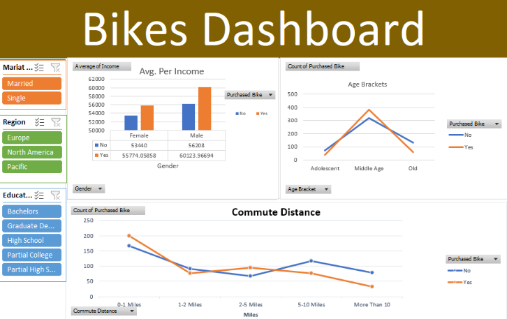

# 🚴 Bike Sales Analysis | Excel Dashboard

## 📌 Project Overview
This project analyzes bike sales customer data using Microsoft Excel. The objective is to understand customer demographics, purchasing behavior, income patterns, and commute distances through data cleaning, Pivot Tables, and an interactive dashboard.

## 🛠️ Tools & Technologies
- Microsoft Excel
- Pivot Tables
- Pivot Charts
- Power Query / Data Cleaning
- Excel Formulas
- Data Visualization

## 📂 Project Structure

| Sheet | Description |
|---|---|
| bike_buyers | Original dataset |
| Clean Data | Cleaned and prepared dataset |
| Pivot Table | Data analysis and summaries |
| Dashboard | Interactive visual dashboard |

## 🧹 Data Cleaning
- Standardized gender values.
- Cleaned marital status categories.
- Organized customer data.
- Created Age Bracket using Excel formulas.
- Prepared data for analysis.

## 📊 Key Analysis

- Average Income Analysis
- Bike Purchases by Commute Distance
- Bike Purchases by Age Bracket
- Customer Income by Gender
- Bike Purchasing Behaviour

## 📈 Dashboard Highlights

The interactive dashboard presents customer purchasing patterns through five visualizations.

## 📸 Dashboard Preview

## 🎯 Skills Demonstrated
- Data Cleaning
- Data Analysis
- Pivot Tables
- Excel Formulas
- Data Visualization
- Dashboard Development

## 👨‍💻 Author

**Khemraj**

Aspiring Data Analyst

Skills: Excel | SQL | Power BI | Python

GitHub: [khemraj-analyst](https://github.com/khemraj-analyst)
